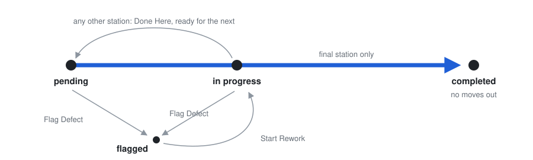

<h1 align="center">Mega Precision Tracking</h1>

<p align="center">Workers scan QR codes to move components through a factory line, and managers see where every part is.</p>

<p align="center">
  <a href="https://github.com/cmengu/MengKiaKnight/actions/workflows/ci.yml"></a>
</p>

<p align="center">
  <picture>
    <source media="(prefers-color-scheme: dark)" srcset="docs/how-it-works-dark.svg">
    
  </picture>
</p>

<p align="center"><sub>The status rules enforced in <code>lib/services/statusTransitions.ts</code>. Drawn from the code, not a screenshot.</sub></p>

## Why

Small manufacturers, such as semiconductor suppliers in Singapore, often have no shared record of which station a component is at. That causes delays and miscommunication. Here a worker scans a station QR and a component QR and picks the next legal status. A manager sees the factory floor map, the parts waiting at each station, and the full scan history.

NUS Orbital 2026, team MengKiaKNIGHT (Apollo 11).

## What is in the app

- Worker page (`/worker`): scans a workstation QR and a component QR, then offers only the moves the rules allow. Each scan updates the component and appends a row to `status_logs`.
- Manager page (`/manager`): overview tiles, component and workstation management, QR label generation, worker approvals, and a QA rerouting action that sends a defective part to a rework station.
- Factory floor map: built with React Flow from the scan history. Arrows are the routes parts actually took, and the busiest station is shown as the bottleneck. It updates through Supabase realtime if realtime is enabled for `components` and `status_logs` (`supabase/floor_view.sql`).
- Ask (`/manager/ask`): a manager types a question, Claude writes one read-only SQL SELECT, and it runs through the `run_readonly_query` RPC for signed-in users. `eval/` holds a 72-question golden set. The committed `eval/report.json` (generated 2026-07-26) records 72 of 72 passing.
- Auth: Supabase Auth with worker and manager roles; new workers wait for manager approval.

## Run it

Needs Node.js 20 (as used in CI) and a Supabase project. Create the schema from `supabase/schema.sql`, then `supabase/floor_view.sql` for the floor map.

```bash
git clone https://github.com/cmengu/MengKiaKnight
cd MengKiaKnight
npm install
```

Create `.env.local`:

```env
NEXT_PUBLIC_SUPABASE_URL=your_supabase_url
NEXT_PUBLIC_SUPABASE_PUBLISHABLE_KEY=your_supabase_publishable_key
```

```bash
npm run dev    # http://localhost:3000
```

Other scripts: `npm test` (unit tests), `npm run typecheck`, `npm run lint`, `npm run eval` (needs `ANTHROPIC_API_KEY`, `NEXT_PUBLIC_SUPABASE_URL` and `SUPABASE_SERVICE_ROLE_KEY`), `npm run seed:factory`. `scripts/seed-demo.ts` creates demo manager and worker accounts.

## Stack

Next.js 16 (App Router) with React 19, Supabase (Postgres, Auth, Realtime), Tailwind CSS 4, `@yudiel/react-qr-scanner`, `qrcode.react`, `@xyflow/react`, `@tanstack/react-table`, and the Anthropic SDK for Ask. CI (`.github/workflows/ci.yml`) runs lint, typecheck, unit tests, build, integration tests and the eval.

## Milestones

| Milestone | Date | Deliverable |
|---|---|---|
| 1 | 1 Jun | Proof of concept: scan a QR, fetch a dummy component, update status |
| 2 | 29 Jun | Prototype: real-time DB integration, live manager dashboard |
| 3 | 27 Jul | Extended system: analytics, idle alerts, Google Sheets export |

## Team

MengKiaKNIGHT, full-stack. NUS School of Computing, Orbital (CP2106) 2026.
